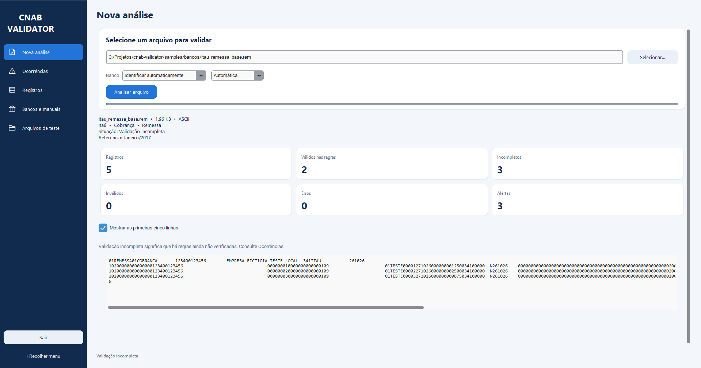
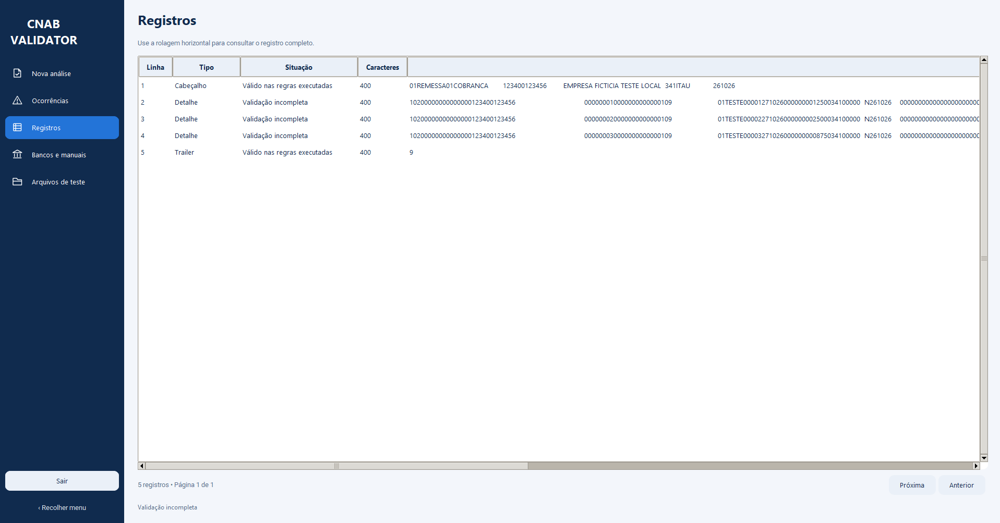
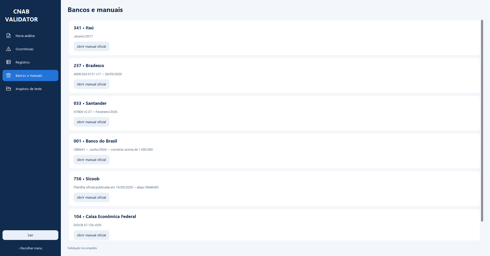

# CNAB Validator

**Inspecione arquivos bancários, encontre inconsistências e exporte os resultados em uma aplicação desktop local.**

O CNAB Validator analisa arquivos de cobrança **CNAB 400**. Ele identifica o banco
pelo conteúdo, confere a estrutura dos registros e verifica campos dos perfis
implementados, apresentando erros, alertas e regras ainda não cobertas.

Desenvolvido em Python, com interface CustomTkinter em azul-marinho, azul e branco.
A versão desktop funciona sem navegador, servidor web ou conta de hospedagem.

[Começar a usar](#instalação) · [Ver as telas](#o-aplicativo-em-funcionamento) · [Bancos e cobertura](#bancos-e-cobertura) · [Arquivos de teste](#arquivos-para-teste)

## Para que serve

O aplicativo ajuda quem precisa conferir arquivos de remessa e retorno, investigar
falhas em integrações bancárias ou estudar a estrutura de registros de largura fixa.
É útil para equipes de suporte, desenvolvimento de sistemas e rotinas financeiras
que precisam localizar uma inconsistência antes de continuar a investigação.

Ele **analisa o arquivo selecionado**: não envia remessas aos bancos, não movimenta
contas e não corrige automaticamente o conteúdo original.

> **Cobertura em evolução:** a aplicação verifica estrutura e campos principais.
> Um resultado sem erros não equivale à homologação ou à aprovação pelo banco.
> Consulte os alertas e o manual adotado pela sua conta.

## Funcionalidades

| Recurso | O que você consegue fazer |
| --- | --- |
| Identificação de banco | Reconhecer banco, serviço e movimento pelo cabeçalho do perfil CNAB 400. |
| Conferência de estrutura | Identificar cabeçalho, detalhes e trailer; localizar sequências incorretas e registros truncados. |
| Verificação de campos | Conferir campos numéricos, datas e conteúdos previstos nos perfis implementados. |
| Conferência de totais | Comparar quantidades e valores nos perfis com essa regra implementada. |
| Diagnóstico por linha | Consultar erros, alertas, posições dos campos e formato esperado quando disponíveis. |
| Filtros de ocorrências | Filtrar por classificação e campo ou pesquisar pelo conteúdo da ocorrência. |
| Consulta de registros | Ver o texto original e a situação de cada linha, com paginação e rolagem horizontal. |
| Relatório CSV | Exportar todas as ocorrências, independentemente dos filtros ativos. |
| Opções de leitura | Usar identificação automática de codificação ou selecionar ASCII, UTF-8, Windows-1252 e Latin-1. |
| Menu lateral | Alternar páginas por ícones e recolher o menu sem perder a análise. |
| Exemplos locais | Acessar 39 cenários sintéticos para experimentar o aplicativo. |

A análise roda em segundo plano para manter a janela responsiva. As tabelas exibem
até **200 linhas por página**; essa paginação não limita o relatório exportado.

## O aplicativo em funcionamento

### Nova análise

Selecione um arquivo, escolha o banco ou mantenha a identificação automática e clique
em **Analisar arquivo**. O resumo mostra nome, tamanho em KB, codificação, banco,
serviço, movimento e situação. Os cartões separam registros, válidos nas regras,
incompletos, inválidos, erros e alertas.

A opção de prévia mostra as cinco primeiras linhas preservando os espaços.



### Registros

Consulte a linha, o tipo do registro, a situação e a quantidade de caracteres.
A rolagem horizontal permite percorrer o conteúdo original sem remover os espaços
que definem as posições dos campos.



### Bancos e manuais

Veja a edição do manual usada como referência em cada perfil. O botão **Abrir manual
oficial** acessa a documentação no navegador. A edição deve ser conferida com a
contratação e a documentação adotadas pela conta.



As capturas acima usam arquivos fictícios fornecidos com o projeto.
O menu **Ocorrências** reúne os filtros e a exportação CSV; **Arquivos de teste**
abre a pasta dos exemplos e seu guia de uso.

## Bancos e cobertura

O escopo atual é **cobrança CNAB 400**, com posições específicas por banco e movimento.

| Banco | Código | Remessa | Retorno | Referência implementada |
| --- | --- | --- | --- | --- |
| Itaú | 341 | Estrutura e campos principais | Estrutura, campos principais e totais | Janeiro/2017 |
| Bradesco | 237 | Estrutura e campos principais | Estrutura e campos principais | 4008.524.0121 v17 — 28/09/2020 |
| Santander | 033 / 353 | Estrutura, campos principais e totais | Estrutura e campos principais | H7800 v2.37 — fevereiro/2026 |
| Banco do Brasil | 001 | CBR641, detalhe 7, convênio acima de 1.000.000 | CBR643 ainda não coberto | Junho/2024 |
| Sicoob | 756 | Estrutura e campos principais | Estrutura, campos principais e quantidade | Abas CNAB400 da planilha oficial publicada em 19/05/2025 |
| Caixa Econômica Federal | 104 | Estrutura e campos principais | Estrutura e campos principais | SIGCB 67.126 v029 |

**A cobertura dos perfis é parcial.** Rateio, mensagens, Pix, outros complementos,
cálculos de dígitos verificadores, tabelas completas de rejeição e regras por carteira,
comando e contratação ainda precisam ser ampliados. As limitações reconhecidas
aparecem como alertas de validação incompleta.

CNAB 240 pode ser identificado, mas **não possui validação bancária implementada**.
A versão informada na tela é a referência do programa, não uma garantia de que o
arquivo pertence àquela edição.

<details>
<summary>Como os totais são conferidos</summary>

- **Itaú retorno:** quantidade de detalhes, soma nominal informada, controle do arquivo e sequência.
- **Santander remessa:** quantidade de registros e soma nominal dos títulos.
- **Sicoob retorno:** quantidade de detalhes.
- Saldos de carteira não são tratados como soma dos movimentos do arquivo.
- Registros truncados e variantes sem cobertura suspendem comparações que dependem de uma soma completa.

</details>

## Instalação

### O que você precisa

- Windows com Python e suporte ao Tkinter instalados.
- A pasta completa do projeto, incluindo `app/` e `samples/`.
- Acesso à internet para instalar as dependências; depois disso, a análise desktop é local.

**Ambiente verificado:** Python 3.14, CustomTkinter 6.0.0 e Pillow 12.3.0.
Em uma instalação padrão do Python para Windows, mantenha habilitado o componente
Tcl/Tk. Os comandos abaixo podem ser executados no PowerShell ou no terminal do VS Code.

### Preparar o ambiente

Na pasta do projeto:

```powershell
git clone https://github.com/DenilsomLobo/cnab-validator.git
cd cnab-validator
python -m venv .venv
.venv\Scripts\python.exe -m pip install -r requirements.txt
```

### Abrir o aplicativo

```powershell
.venv\Scripts\python.exe interface.py
```

Depois da instalação, também é possível dar **dois cliques em `iniciar_desktop.cmd`**.
O iniciador usa o ambiente `.venv` da pasta do projeto e abre a janela sem console.
Se ocorrer uma falha de inicialização, ele apresenta uma mensagem e tenta registrar
os detalhes em `erro_desktop.log`.

Não é necessário executar `streamlit run` para usar a versão desktop.

## Primeiro uso

1. Abra **Nova análise** e clique em **Selecionar…**.
2. Escolha um arquivo `.rem`, `.ret`, `.txt`, `.tst` ou `.rst`.
3. Mantenha **Identificar automaticamente** ou selecione o banco esperado.
4. Deixe a codificação em **Automática**, ajustando-a se conhecer a origem do arquivo.
5. Clique em **Analisar arquivo** e confira a situação e os indicadores.
6. Consulte **Ocorrências** para filtrar os diagnósticos e **Registros** para inspecionar as linhas.
7. Use **Exportar CSV completo** para salvar todas as ocorrências.

| Atalho | Ação |
| --- | --- |
| `Ctrl+O` | Selecionar arquivo. |
| `Ctrl+S` | Exportar o relatório da análise atual. |

Trocar o arquivo, banco ou codificação limpa o resultado anterior. Execute a análise
novamente para que o resultado corresponda às opções selecionadas.

## Como interpretar o resultado

| Situação | Significado |
| --- | --- |
| **Inválido** | A linha tem pelo menos uma ocorrência classificada como `ERRO`. |
| **Validação incompleta** | Não há erro naquela linha, mas há verificações pendentes ou limitações sinalizadas. |
| **Válido nas regras executadas** | As verificações aplicadas passaram. Não representa aprovação do banco. |

As três contagens não se sobrepõem. Um alerta não invalida o registro, e um erro tem
prioridade quando a mesma linha também possui um alerta. Alertas com linha zero
representam uma limitação do arquivo inteiro.

O relatório CSV contém linha, campo, valor encontrado, classificação, motivo, posição
inicial, posição final, formato esperado e referência ao manual. Posição zero indica
uma ocorrência do arquivo ou uma regra sem um campo posicional único. Conteúdos que
poderiam ser interpretados como fórmulas são protegidos na exportação.

## Arquivos para teste

O menu **Arquivos de teste** abre [`samples/bancos/`](samples/bancos/), que contém
**39 cenários sintéticos**, com contas, empresas e pagadores fictícios.

- Arquivos `*_remessa_base.rem` e `*_retorno_base.ret` exercitam as regras atuais sem erros propositais.
- Outros exemplos incluem data impossível, sequência incorreta, registro truncado, ausência de trailer e totais divergentes.
- Os arquivos base possuem cinco registros de 400 bytes, em ASCII e com quebras de linha CRLF.
- Os títulos somam **R$ 462,50**. O retorno do BB não foi simulado como um perfil implementado.

Consulte o [guia dos exemplos](samples/bancos/LEIA-ME.md), as
[expectativas por arquivo](samples/bancos/resultados_esperados.json) ou o
[pacote ZIP](samples/cnab_testes.zip).

Para gerar novamente os exemplos e o ZIP:

```powershell
.venv\Scripts\python.exe samples\gerar_cnab_bancos.py
```

Os exemplos servem para teste local do software e **não são arquivos oficiais de
homologação**. O arquivo `samples/exemplo.rem` é um exercício didático anterior,
com posições diferentes; seu perfil está disponível na interface web opcional.

## Tecnologias

| Tecnologia | Uso no projeto |
| --- | --- |
| **Python** | Leitura, interpretação e validação dos arquivos. |
| **CustomTkinter** | Janela desktop, páginas, botões e menu lateral com ícones. |
| **Tkinter / ttk** | Seleção de arquivos, mensagens e tabelas. |
| **Pillow** | Desenho dos ícones da navegação. |
| **threading / queue** | Análise em segundo plano e entrega dos resultados à interface. |
| **pathlib / csv** | Manipulação de caminhos e exportação de relatórios. |
| **pytest** | Testes de validação, exemplos, filtros e interface. |
| **Streamlit — opcional** | Interface web anterior, preservada separadamente. |

As versões das dependências desktop estão em [`requirements.txt`](requirements.txt).
As dependências web e de desenvolvimento ficam em arquivos separados.

## Organização do projeto

```text
cnab-validator/
├── interface.py                 # Entrada desktop
├── iniciar_desktop.cmd          # Iniciador Windows
├── iniciar_desktop.pyw          # Abertura sem console e tratamento de falhas
├── main.py                      # Interface de terminal
├── interface_web.py             # Interface web opcional
├── app/
│   ├── desktop.py               # Páginas, navegação e tarefas em segundo plano
│   ├── desktop_theme.py         # Paleta e estilos
│   ├── desktop_icons.py         # Ícones do menu
│   ├── desktop_service.py       # Leitura e filtros independentes dos widgets
│   ├── bancos.py                # Identificação e motor multibanco
│   ├── layouts.py               # Campos, versões e links dos manuais
│   ├── itau.py                  # Regras específicas do Itaú
│   ├── reader.py                # Codificações e preservação dos registros
│   ├── resultados.py            # Estados e contagens da análise
│   └── report.py                # Relatórios CSV
├── samples/
│   ├── bancos/                  # Cenários CNAB sintéticos
│   └── img/                     # Capa e capturas do aplicativo
├── docs/                        # Documentação da cobertura dos perfis
├── tests/                       # Testes automatizados
├── requirements.txt             # Dependências desktop
├── requirements-web.txt         # Dependências web opcionais
└── requirements-dev.txt         # Dependências de desenvolvimento
```

O código mantém funções em português, dicionários e comentários acima dos mecanismos.
Os links oficiais ficam em [`app/layouts.py`](app/layouts.py). A
[documentação de cobertura](docs/COBERTURA.md) registra o escopo dos perfis.
Os manuais são acessados nas fontes oficiais; a planilha Sicoob tem CNAB240 no
nome, mas também contém abas CNAB400.

## Desenvolvimento e testes

Instale o ambiente de desenvolvimento e execute a suíte:

```powershell
.venv\Scripts\python.exe -m pip install -r requirements-dev.txt
.venv\Scripts\python.exe -m pytest -q
```

Os testes usam dados sintéticos. Os testes de interface desktop criam widgets reais
e precisam de uma sessão gráfica disponível. Eles não comprovam homologação nos bancos.

Para executar a interface de terminal:

```powershell
.venv\Scripts\python.exe main.py
```

<details>
<summary>Executar a interface web anterior</summary>

A instalação web é opcional e não é necessária para a janela desktop.

```powershell
.venv\Scripts\python.exe -m pip install -r requirements-web.txt
.venv\Scripts\python.exe -m streamlit run interface_web.py
```

Abra a URL exibida no terminal e mantenha esse processo aberto durante o uso da versão web.

</details>

## Dúvidas frequentes

**O arquivo não é identificado.** Confira se é cobrança CNAB 400, se o cabeçalho está
presente e se o banco ou movimento possui perfil implementado. Não aplique as posições
de um banco a outro.

**O texto ficou incorreto.** Confirme a codificação usada pelo sistema que gerou o
arquivo e ajuste a opção de leitura. O programa preserva os espaços das linhas;
não abra e salve os arquivos em editores que removam esse preenchimento.

**O exemplo base mostra validação incompleta.** Isso é esperado: o programa sinaliza
regras bancárias ainda não cobertas, mesmo quando não encontra erros nas verificações executadas.

**O aplicativo não abre.** Confira a instalação do Python com Tcl/Tk, a pasta `.venv`
e as dependências. Execute `interface.py` pelo terminal para consultar a mensagem de erro.
O iniciador sem console também tenta gravar `erro_desktop.log` na pasta do projeto.

**Os arquivos são enviados para algum serviço?** A análise desktop ocorre localmente.
Os botões de manuais abrem sites externos apenas quando acionados. O CSV é salvo no
local escolhido pelo usuário; a versão de terminal grava relatórios em `relatorios/`.

## Autor

Desenvolvido por [Denilsom Lobo](https://github.com/DenilsomLobo).
